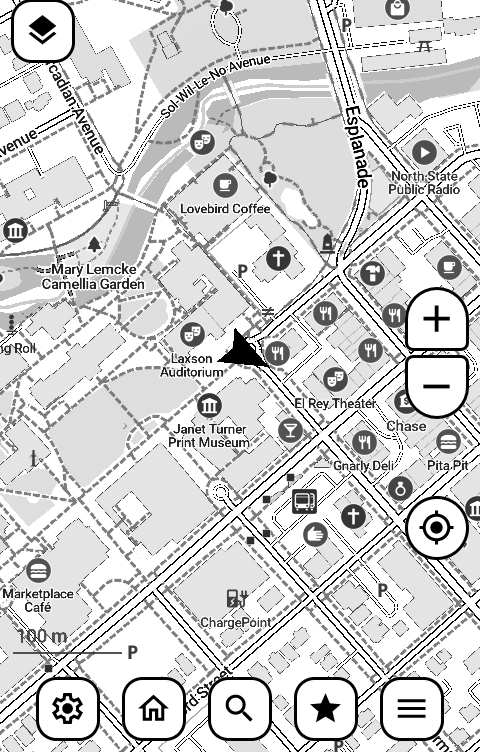
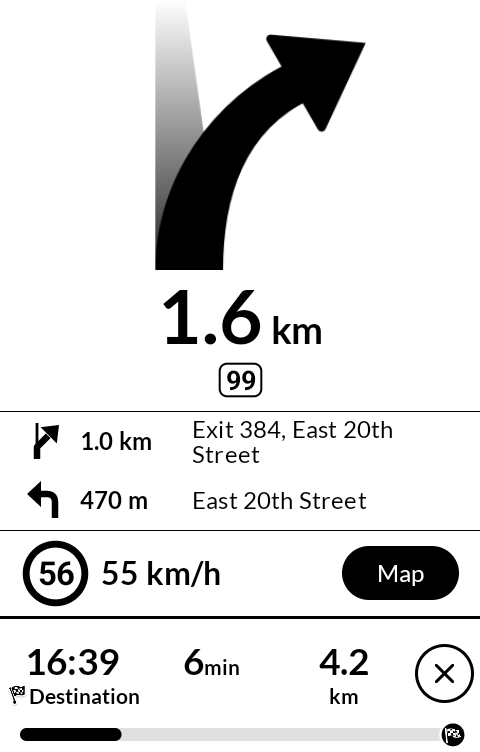
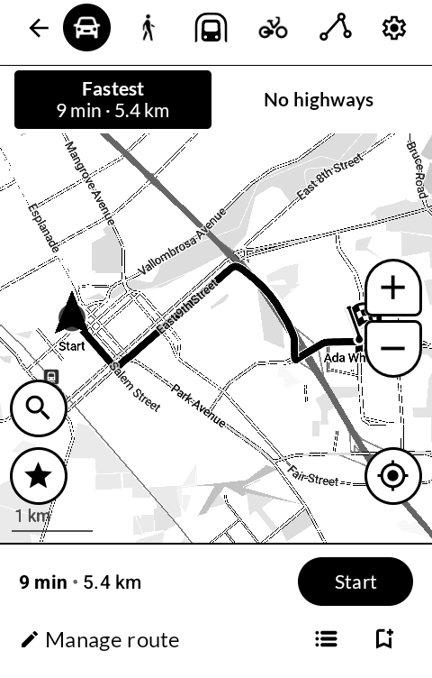
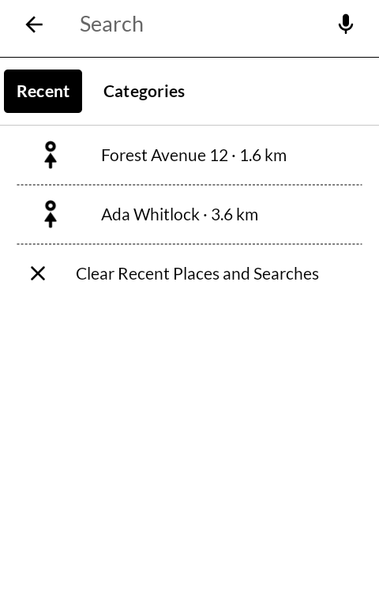

# Atlas

地図 *chizu* — a map: the ground drawn on paper, to be read rather than watched.

| | |
|---|---|
|  |  |
|  |  |

An offline map of the world for an E Ink phone. Download a region once, then search it,
find a route and follow it by car, on foot or by bike, with no connection. Black on white,
and nothing on the screen that moves unless you moved it.

Built for the [Mudita Kompakt](https://mudita.com/products/kompakt/), whose 4.3" panel has
sixteen grays and a slow redraw. It needs Android 11 or later.

## Where it comes from

Atlas is [CoMaps](https://codeberg.org/comaps/comaps) in house dress. The map engine, the
search, the routing and the Android app around them are the work of the CoMaps
contributors, and before them of Organic Maps and MAPS.ME. The maps are made from
[OpenStreetMap](https://www.openstreetmap.org/copyright). Atlas is a separate project and
has no connection to any of them.

What Atlas changes:

- **The look.** One ink on white, in the app's own screens: white bars with a rule under
  them, Lato from 16 sp, dialogs with a rim instead of a shadow, no ripples and no dimming.
- **The motion.** A map on E Ink should land, not glide. Zooming and jumping to a place
  happen in one step, there is no coasting after a drag, and the map opens flat, without 3D
  buildings or a tilted view.
- **The drive.** While a route is followed, a card covers the map: the next turn in large
  type with its distance and road, the two turns after it, the speed limit and your speed
  in steps of five. The map is one tap away and, while it shows, moves once every five
  seconds. A round button in the foot stops the drive on its second tap.
- **Getting going.** A Home button on the map plans the way home in one tap; the places
  you last drove to head the search screen. While planning, the fastest route and one
  that keeps off the highways are side by side.
- **What is left out.** No map editing and no OpenStreetMap sign-in, so no account of any
  kind. No donation prompts. One build, with no store variants.
- **About and Licenses.** The same two pages as in the other wander wildwood apps. The
  Licenses list is made by the build; the rows for the map engine's own libraries, data,
  fonts and icons are taken from CoMaps' notice page (`data/copyright.html`) by
  `android/config/gen-credits.py`.

Everything else is CoMaps as it is: the offline search, car, walking and cycling routes
(spoken, where the phone has a speech engine), favorites and recorded tracks, and import
and export of KML, KMZ and GPX files.

## What it sends, and what it does not

Your position, searches, routes, favorites and tracks stay on the phone. The network is
used to download the maps you choose, from the CoMaps map servers. Nothing goes to the
developer. The whole of it is in [PRIVACY.md](PRIVACY.md).

## Building

Atlas builds the way CoMaps does: see [docs/INSTALL.md](docs/INSTALL.md). The Android app
is in `android/`; the build is `assembleFdroidDebug` or `assembleFdroidRelease`. A debug
build needs `-PdisableHWAsan`.

A release build is signed with a key in a `signing/` folder that is not in this
repository. Without it, the release comes out unsigned.

## License

Atlas is licensed under the GNU General Public License, version 3 only: see
[LICENSE](LICENSE). It is built from CoMaps, whose code stays under the Apache License
2.0: see [LICENSE-APACHE](LICENSE-APACHE), [NOTICE](NOTICE) and
[data/copyright.html](data/copyright.html).

Contact: email@wanderthe.dev
